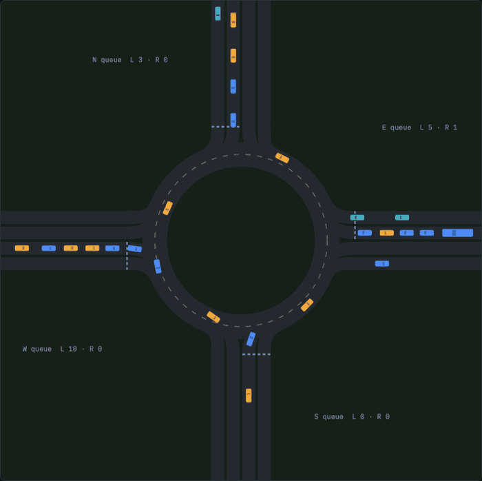
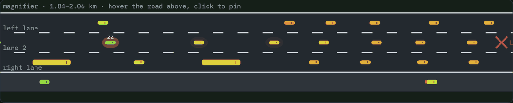
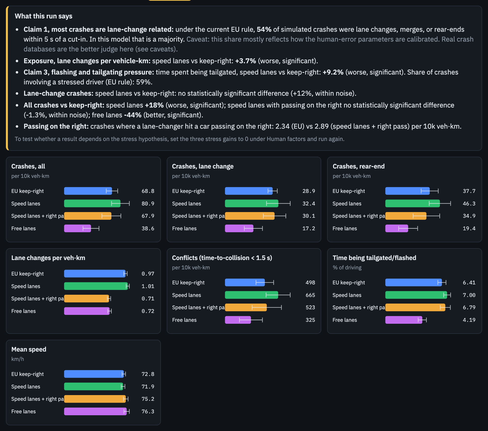
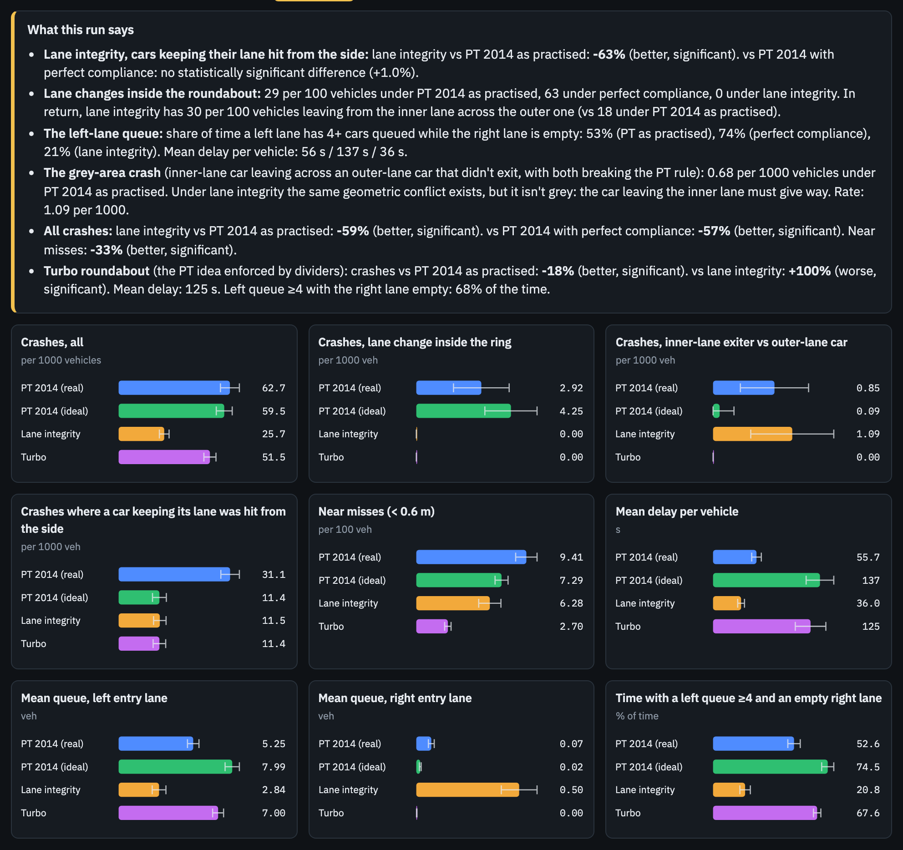
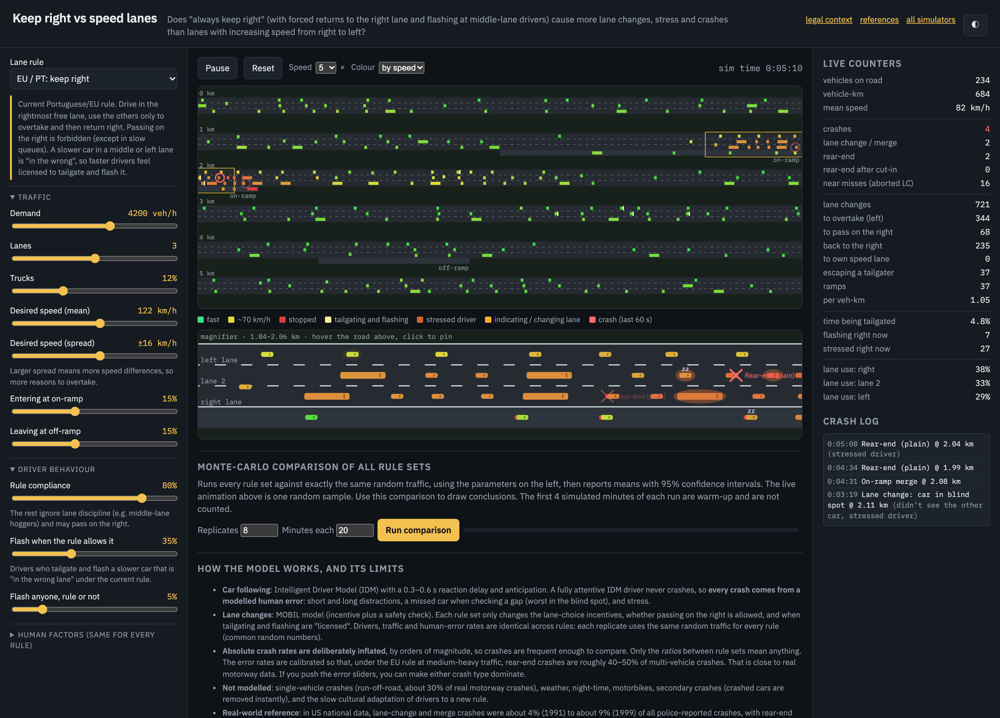
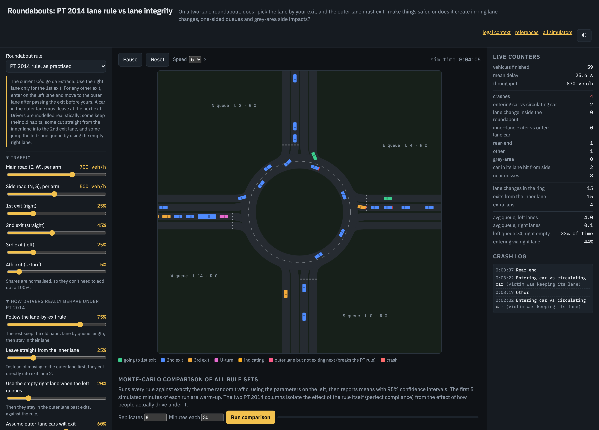

# Portuguese Road Code: two rules, simulated

Two traffic micro-simulations that put two long-standing arguments about the Portuguese *Código da Estrada* to the test, without rigging them for either side.

| Simulator | Question |
|---|---|
| 🛣️ **Highway**: keep right vs speed lanes | Does the EU/PT "always keep right" rule, with its constant returns to the right lane and flashing at middle-lane drivers, cause more lane changes, stress and crashes than lanes with increasing speed from right to left (US/Middle-East style)? |
| 🔄 **Roundabout**: PT 2014 vs lane integrity vs turbo | On a two-lane roundabout, does the 2014 rule ("choose your lane by your exit; the outer lane must exit") make things safer, or does it cause in-ring lane changes, one-sided queues and grey-area side impacts? |

Each simulator is a self-contained web page with a live animation, sliders for every assumption, and a Monte-Carlo comparison that runs every rule set against identical traffic and reports means with 95% confidence intervals. Each page ends with annexes on the legal context and references.

<p align="center">
  
  <br><sub>PT 2014 rule at 2,400 veh/h. Cars are coloured by destination exit. Watch the west arm: a long left-lane queue next to an empty right lane.</sub>
</p>

<p align="center">
  
  <br><sub>Highway magnifier at the on-ramp merge: flashing tailgaters (light beams), stressed drivers (orange halo), distracted drivers (zz), and a blind-spot lane-change crash.</sub>
</p>

---

## Quick start

```sh
npm install
npm run dev                  # both simulators at http://localhost:5173
```

Build each simulator as a single, dependency-free HTML file you can open or share on its own:

```sh
npm run build:highway        # → dist/highway/index.html
npm run build:roundabout     # → dist/roundabout/index.html
```

Run the headless experiments (same engine as the in-page "Run comparison" button):

```sh
npm run batch:highway    -- --reps 12 --minutes 20 --demand 4200 [--stress 0] [--flash 0] [--compliance 0.95]
npm run batch:roundabout -- --reps 12 --minutes 30 [--main 600 --side 400] [--perfect 1] [--trust 0] [--cut 0 --jump 0]
./run-experiments.sh         # regenerates every table in results/
```

---

## Findings so far

Absolute crash rates are **deliberately inflated** so crashes happen often enough to measure. Only the *differences between rule sets* mean anything. Full tables are in [`results/`](results).

### Highway: the claims were mostly not supported

3 lanes, 12 replicates × 20 min per setting.

| Claim | Result |
|---|---|
| Most motorway crashes happen during lane changes | **Not testable by simulation.** The share depends on calibration (about 50% here). US national data put lane-change and merge crashes at about 4–9% of all police-reported crashes, with rear-end crashes the larger category. |
| Speed lanes reduce lane changes | Only in light traffic (−20% at 2,500 veh/h). Same or more in medium and heavy traffic. |
| Speed lanes (overtake left only) are safer than keep-right | **No: not safer at any demand level.** At 4,200 veh/h it came out 15–18% *worse* (significant in some runs, within noise in others). |
| … with passing on the right allowed | −27% lane changes, no significant safety difference. |
| Flashing and tailgating pressure is the real danger | **Supported, by a different mechanism.** "Free lanes" (only the leftmost lane must be kept clear) had −44% crashes at 4,200 veh/h and −24% at 5,200. The advantage disappears when nobody flashes, and acts mainly through tailgating (rear-end crashes) rather than stress (missed cars). |



### Roundabout: the claims were largely supported

2,000 veh/h across four arms, 12 replicates × 30 min.

| | PT 2014 as practised | PT 2014 ideal (≈ Spain) | Lane integrity (≈ UK) | Turbo |
|---|---|---|---|---|
| All crashes (per 1000 veh) | 62.7 | 62.2 | **24.3** | 55.7 |
| Car keeping its lane hit from the side (per 1000 veh) | 31.6 | 9.8 | 10.6 | 10.0 |
| Near misses (per 100 veh) | 9.7 | 6.6 | 5.8 | **3.0** |
| Lane changes inside the ring (per 100 veh) | 28 | 63 | 0 | 0 |
| Mean delay | 55 s | 137 s | **36 s** | 115 s |
| Left lane queued (≥4) while right lane empty | 51% | 76% | **21%** | 77% |

- Lane integrity beats PT 2014 on nearly every measure.
- The "grey-area" crash (an inner-lane car leaving across an outer-lane car that didn't exit) is real but rare: about 1% of PT crashes. Entry conflicts and queue rear-ends matter far more.
- An unexpected structural issue in PT 2014: moving out to the outer lane "after passing the exit before yours" happens exactly where the previous arm's entrants merge in. It produces crashes even with error-free drivers.
- **Turbo** (the PT idea enforced by raised lane dividers) is the cleanest design *inside* the ring. It has no lane changes, no exit crossings and the fewest near misses. But lane-by-exit allocation at entry causes the same left-lane queues, so overall it doesn't beat lane integrity. The turbo variant is a simplified symmetric layout and is probably pessimistic about queues.
- With every human error switched off, the roundabout still produces about 11 crashes per 1000 vehicles under lane integrity. That baseline comes from imperfections in the give-way model and affects every rule, so treat small differences with caution.



<details>
<summary>Full app screenshots</summary>




</details>

---

## How the models work

### Crashes are never scripted

Car following uses the **Intelligent Driver Model** (Treiber et al., 2000) with a 0.3–0.6 s reaction delay and anticipation (Human Driver Model, Treiber et al., 2006). A fully attentive IDM driver never crashes, so every crash comes from an explicit, parameterised human failure ([`src/shared/driver.ts`](src/shared/driver.ts)):

- **Attention lapses**: short glances (about 1/min, about 1 s) and long distractions (about 0.3/min, about 3 s). The driver keeps the previous pedal input while distracted.
- **Perception misses**: when checking a gap, a car can go unseen. This is 8× more likely in the blind spot and 2.5× for fast-approaching cars. What you saw (or missed) persists for a few seconds rather than being re-rolled every tick.
- **Stress**, from being tailgated or flashed: it raises misses, lengthens lapses, and makes drivers accept tighter gaps. This is one of the hypotheses under test, so each effect has its own slider and can be set to zero.

### Fair comparison

Every rule set sees **identical random traffic**: same arrival times, same drivers, same error rates ("common random numbers"). Rules change only lane choice, overtaking permissions, in-ring behaviour, what drivers expect of each other, and when tailgating is "socially licensed". Differences are tested with paired 95% confidence intervals.

### Calibration

Error rates were tuned so that (a) error-free drivers don't crash on the highway, and (b) under the EU rule in medium-heavy traffic, rear-end crashes are about 40–50% of multi-vehicle crashes. This stops the model from "proving" that lane changes cause most crashes by construction.

### Highway ([`src/highway`](src/highway))

A 6 km, 3-lane (2–4 configurable) carriageway with an on-ramp at 1.8–2.1 km, an off-ramp at 4.2 km and 12% trucks (barred from the leftmost lane). Lane changes use **MOBIL** (Kesting et al., 2007) with rule-specific incentives:

| Rule | Lane choice | Pass on the right | Flashing "licensed" when the slower car is… |
|---|---|---|---|
| EU keep right | rightmost free lane, return right after overtaking | no (except slow queues) | in any lane but the rightmost |
| Speed lanes | the lane matching your cruising speed | no | in the leftmost lane, or well below its lane's speed |
| Speed lanes + right pass | same | yes | same |
| Free lanes | the fastest lane | yes | in the leftmost lane |

Crashes are classified as blind spot, car passing on the right, fast car from behind, simultaneous merge, ramp merge, rear-end, or rear-end right after a cut-in.

### Roundabout ([`src/roundabout`](src/roundabout))

Four arms, two circulating lanes (radius 26 m and 30 m), two-lane entries and exits, counter-clockwise circulation. **Lane occupancy is decided by geometry**: a car whose body is in the outer lane *is* in the outer lane for every other driver. Collisions are oriented-rectangle overlaps. Entries and inner-lane exits use a conflict-zone gap test (in the spirit of SUMO), re-checked until the point of no return.

| Rule | Entry lane | Inside the ring | Leaving |
|---|---|---|---|
| **PT 2014 as practised** (Lei 72/2013, art. 14.º-A) | right lane for the 1st exit only, left otherwise | move out after the previous exit | from the outer lane, plus realistic non-compliance: old habits, cutting across from the inner lane, right-lane queue jumping, trusting that outer cars will exit |
| **PT 2014 ideal** (≈ Spain's DGT rule) | same | same | from the outer lane only, otherwise go round again |
| **Lane integrity** (≈ UK Highway Code rule 186) | right lane for 1st and 2nd exits, left lane for 2nd–4th | stay in lane | from your lane; inner cars give way to outer cars carrying on |
| **Turbo** (Dutch style, simplified) | right lane for 1st exit only, left otherwise | no lane changes possible | outer lane ends at each exit; inner cars leave directly |

### Not modelled

Single-vehicle crashes, weather, night, motorbikes, pedestrians, cyclists, the PT exemption for heavy vehicles and cyclists, asymmetric real-world turbo layouts, secondary crashes (crashed cars are removed), and long-term driver adaptation to a new rule.

---

## Legal context

There is no EU-level harmonisation of these behaviour rules; they are national. Portugal's roundabout rule is article 14.º-A, added by Lei 72/2013 (in force 1 January 2014). Spain enforces essentially the same rule, the UK's Highway Code recommends lane integrity, and the Netherlands enforces lane choice physically with turbo roundabouts (about 70–76% fewer crashes than conventional two-lane roundabouts, per Fortuijn 2009). Each simulator page has full annexes with sources.

## Key references

- Treiber, Hennecke & Helbing (2000). Congested traffic states in empirical observations and microscopic simulations. *Phys. Rev. E* 62, 1805. [doi:10.1103/PhysRevE.62.1805](https://doi.org/10.1103/PhysRevE.62.1805)
- Treiber, Kesting & Helbing (2006). Delays, inaccuracies and anticipation in microscopic traffic models. *Physica A* 360, 71–88. [doi:10.1016/j.physa.2005.05.001](https://doi.org/10.1016/j.physa.2005.05.001)
- Kesting, Treiber & Helbing (2007). General lane-changing model MOBIL for car-following models. *TRR* 1999, 86–94. [doi:10.3141/1999-10](https://doi.org/10.3141/1999-10)
- Lopez et al. (2018). Microscopic Traffic Simulation using SUMO. *IEEE ITSC*. [doi:10.1109/ITSC.2018.8569938](https://doi.org/10.1109/ITSC.2018.8569938)
- Fortuijn (2009). Turbo roundabouts: safety performance. *TRR* 2096. [doi:10.3141/2096-03](https://journals.sagepub.com/doi/10.3141/2096-03)
- Fitch et al. (2009). *Analysis of Lane-Change Crashes and Near-Crashes*. NHTSA DOT HS 811 147. [pdf](https://www.nhtsa.gov/sites/nhtsa.gov/files/811147.pdf)
- [Lei n.º 72/2013, Diário da República](https://diariodarepublica.pt/dr/detalhe/lei/72-2013-499526) · [DGT: Glorietas](https://www.dgt.es/muevete-con-seguridad/conviertete-en-un-buen-conductor/consejos-generales/como-circular-rotondas/) · [Highway Code rule 186](https://theorytest.org.uk/hwc/highway-code/rule-186.html)

## Project layout

```
src/shared/      RNG, statistics, IDM + human factors, experiment runner, UI kit, styles
src/highway/     model, renderer, page, web worker, rule/metric metadata, verdict, CLI
src/roundabout/  geometry, model, renderer, page, web worker, metadata, verdict, CLI
results/         outputs of run-experiments.sh
```

Plain TypeScript and Canvas, built with Vite. No runtime dependencies.
